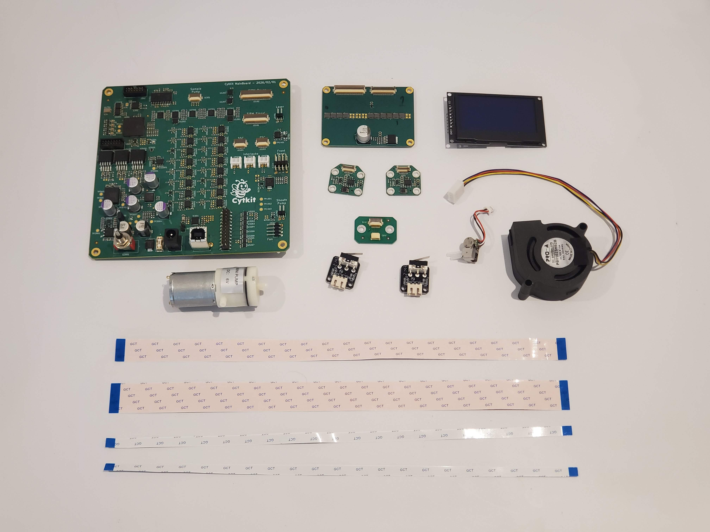

# Astute Devices Cytometry Electronics Kit CYKIT-E-1

#### For Cytkit 2S-14F, coming soon!

This kit provides all the electronics you need for a Cytkit 2S-14F:

1. [Cytometer control board]
1. [Photodiode board] x2
1. [SiPM array board]
1. [Pump connector board]
1. [Interlock switches] x2
1. [OLED display]
1. [Blower fan]
1. [USB camera module]
1. [Vacuum pump for sheath]
1. [Peristaltic pump for sample]
1. [Ribbon connector set]
1. [36V DC power supply]
1. [USB A to USB B cable]
[Cytometer control board]:../electronic/cytometer_control_board.md ""
[Photodiode board]:../electronic/photodiode_board.md ""
[SiPM array board]:../electronic/sipm_array_board.md ""
[Pump connector board]:../electronic/pump_connector_board.md ""
[Interlock switches]:../electronic/interlock_switches.md ""
[OLED display]:../electronic/oled_display.md ""
[Blower fan]:../electronic/blower_fan.md ""
[USB camera module]:../electronic/camera.md ""
[Vacuum pump for sheath]:../fluidic/sheath_pump.md ""
[Peristaltic pump for sample]:../fluidic/sample_pump.md ""
[Ribbon connector set]:../electronic/ribbon_connectors.md ""
[36V DC power supply]:../electronic/36v_dc_power_supply.md ""
[USB A to USB B cable]:../electronic/usb_a_to_b_cable.md ""