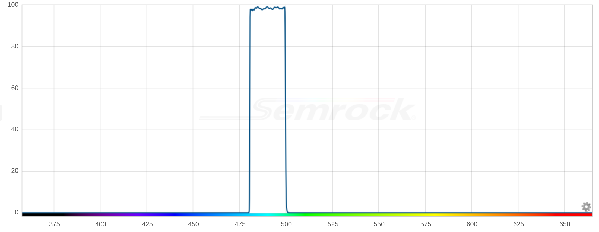

# Band pass dichroic filter

490/15 nm single-band bandpass filter, 12.5 mm square

---

## Specifications

|Attribute |Value|
|---|---|
|band pass|490/15 nm|
|overall size|12.5 mm square|

## Suppliers

|Supplier |Part Number|
|---|---|
|Semrock|[FBP01-490/15-12.5](https://www.idex-hs.com/store/product-detail/fbp01_490_15_12_5?cat_id=semrock_optical_filters&node=individual_optical_filters){:target="_blank"}|
