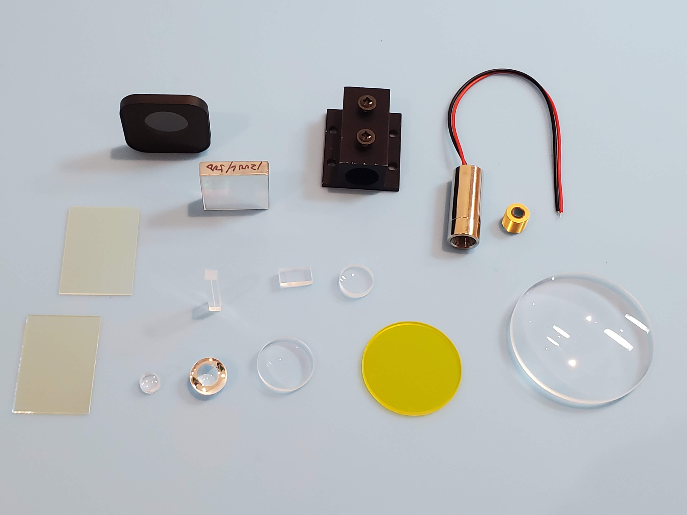
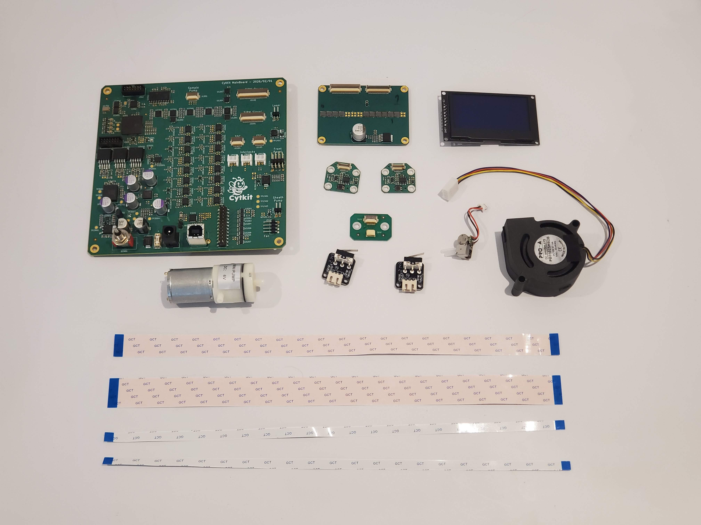
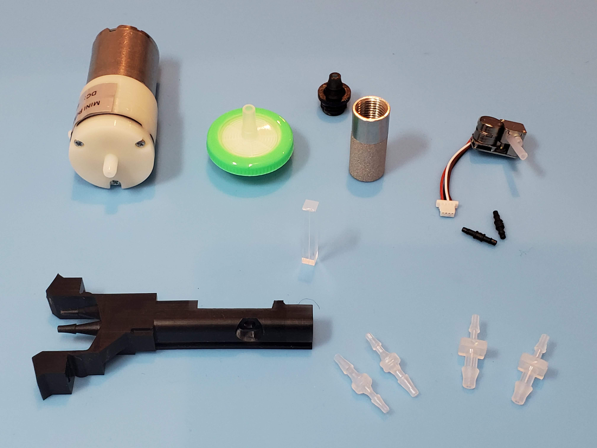

# Source the optical, electronic, fluidic and mechanical components

Apart from the 3D printed parts, Cytkit requires a set of specialised components: optical, electronic and fluidic, as well as a few non-printed mechanical components. These are listed below along with recommended sources.

> We intend to supply full kits shortly, with all recommended components, to make it easier to get started with Cytkit.

## Source the safety equipment

1. [Laser safety glasses]

## Source the optical components

1. [Laser focus lens spherical]
1. [Laser focus lens cylindrical]
1. [Blazed reflection grating]
1. [Neutral density filter]
1. [Dichroic longpass filter at 45 degrees (beamsplitter)]
1. [Dichroic longpass filter at 0 degrees]
1. [Coloured glass longpass filter]
1. [Condensing lens]
1. [Spectrum focusing lens]
1. [SSC focusing lens]
1. [F7D8 aspherical lens]
1. [488 nm laser module]
1. [Laser collimating lens]
1. [Laser heatsink]
1. [Band pass dichroic filter]
1. [Cylindrical correction lens]

## Source the fluidic components

1. [Vacuum pump for sheath]
1. [Peristaltic pump for sample]
1. [Bottom-of-bottle filter]
1. [Silicone tubing 1 mm ID]
1. [Silicone tubing 1.6 mm ID]
1. [Silicone tubing 4 mm ID]
1. [Tube barb union 1.6x2.4]
1. [Tube barb union 1.6x3.2]
1. [Tube barb union 2.4x6.4]
1. [Quartz cuvette or thick-walled capillary]
1. [Pressure-resistant bottle]
1. [Peek tubing 1.6mm OD 0.25mm ID]
1. [Nitrile black O-rings ID 1mm CS 1mm]

## Source the electronic components

According to the configuration you are building:

### For the Cytkit 1S-1F configuration:

1. [Amplified photodiode (Thorlabs PDA10)]
1. [Photomultiplier tube module (Hamamatsu H10732)]
1. [USB oscilloscope (Picoscope 5000 series)]
1. [Vacuum pump controller board]
1. [Stepper motor controller board]
1. [BNC (Male) to BNC (Male) cable, 1 m]
1. [SMA (Female) to BNC (Male) adapter]
1. [Linear Power Supply]
1. [Laboratory Power Supply]
1. [USB camera module]

### For the Cytkit 2S-14F configuration:

> All electronic components are available in the Astute Devices Cytometry Electronics Set CYKIT-E-1, or in the Cytkit Full Kit CYKIT-K-1, anticipated to launch Q4 2026. Further details coming soon!

1. [Cytometer control board]
1. [Photodiode board] x2
1. [SiPM array board]
1. [Pump connector board]
1. [Interlock switches] x2
1. [OLED display]
1. [Blower fan]
1. [USB camera module]
1. [Ribbon connector set]
1. [36V DC power supply]
1. [USB A to USB B cable]

## Source the mechanical components

1. [M3 self-tapping hex socket cap screws 25 mm]
1. [M3 self-tapping posi head screws 6 mm]
1. [M3 self-tapping posi head screws 8 mm]
1. [M3 self-tapping posi head screws 10 mm]
1. [M3 self-tapping posi head screws 12 mm]
1. [M3 self-tapping posi head screws 16 mm]
1. [M2.6 self-tapping posi head screws 6 mm]
1. [M3 washers]
1. [Stainless steel compression springs, 0.5 mm wire, 20 mm length, 6 mm diameter]
1. [Stainless steel extension springs, 0.3 mm wire, 20 mm length, 6 mm diameter]
1. [M4 thumb screws 10mm]
[Laser safety glasses]:safety/laser_safety_glasses.md ""
[Laser focus lens spherical]:optical/laser_focus_lens_spherical.md ""
[Laser focus lens cylindrical]:optical/laser_focus_lens_cylindrical.md ""
[Blazed reflection grating]:optical/blazed_reflection_grating.md ""
[Neutral density filter]:optical/nd_filter.md ""
[Dichroic longpass filter at 45 degrees (beamsplitter)]:optical/dichroic_longpass_45.md ""
[Dichroic longpass filter at 0 degrees]:optical/dichroic_longpass.md ""
[Coloured glass longpass filter]:optical/coloured_glass_longpass.md ""
[Condensing lens]:optical/condensing_lens.md ""
[Spectrum focusing lens]:optical/spectrum_focusing_lens.md ""
[SSC focusing lens]:optical/ssc_focusing_lens.md ""
[F7D8 aspherical lens]:optical/F7D8_aspherical_lens.md ""
[488 nm laser module]:optical/laser_module.md ""
[Laser collimating lens]:optical/laser_collimating_lens.md ""
[Laser heatsink]:optical/laser_heatsink.md ""
[Band pass dichroic filter]:optical/band_pass_dichroic.md ""
[Cylindrical correction lens]:optical/cylindrical_correction_lens.md ""
[Vacuum pump for sheath]:fluidic/sheath_pump.md ""
[Peristaltic pump for sample]:fluidic/sample_pump.md ""
[Bottom-of-bottle filter]:fluidic/bottom_of_bottle_filter.md ""
[Silicone tubing 1 mm ID]:fluidic/silicone_tubing_1mm.md ""
[Silicone tubing 1.6 mm ID]:fluidic/silicone_tubing_1.6mm.md ""
[Silicone tubing 4 mm ID]:fluidic/silicone_tubing_4mm.md ""
[Tube barb union 1.6x2.4]:fluidic/tube_barb_union1.6x2.4.md ""
[Tube barb union 1.6x3.2]:fluidic/tube_barb_union1.6x3.2.md ""
[Tube barb union 2.4x6.4]:fluidic/tube_barb_union2.4x6.4.md ""
[Quartz cuvette or thick-walled capillary]:fluidic/cuvette.md ""
[Pressure-resistant bottle]:fluidic/pressure_resistant_bottle.md ""
[Peek tubing 1.6mm OD 0.25mm ID]:fluidic/peek_tubing.md ""
[Nitrile black O-rings ID 1mm CS 1mm]:fluidic/o-rings.md ""
[Amplified photodiode (Thorlabs PDA10)]:components/thorlabs_pda10.md ""
[Photomultiplier tube module (Hamamatsu H10732)]:components/hamamatsu_H10732.md ""
[USB oscilloscope (Picoscope 5000 series)]:components/picoscope.md ""
[Vacuum pump controller board]:electronic/vacuum_pump_controller.md ""
[Stepper motor controller board]:electronic/stepper_controller.md ""
[BNC (Male) to BNC (Male) cable, 1 m]:electronic/bnc_cable.md ""
[SMA (Female) to BNC (Male) adapter]:electronic/sma_bnc_adapter.md ""
[Linear Power Supply]:electronic/linear_power_supply.md ""
[Laboratory Power Supply]:electronic/laboratory_power_supply.md ""
[USB camera module]:electronic/camera.md ""
[Cytometer control board]:electronic/cytometer_control_board.md ""
[Photodiode board]:electronic/photodiode_board.md ""
[SiPM array board]:electronic/sipm_array_board.md ""
[Pump connector board]:electronic/pump_connector_board.md ""
[Interlock switches]:electronic/interlock_switches.md ""
[OLED display]:electronic/oled_display.md ""
[Blower fan]:electronic/blower_fan.md ""
[Ribbon connector set]:electronic/ribbon_connectors.md ""
[36V DC power supply]:electronic/36v_dc_power_supply.md ""
[USB A to USB B cable]:electronic/usb_a_to_b_cable.md ""
[M3 self-tapping hex socket cap screws 25 mm]:mechanical/screws/self_tapping_m3x25_hex_socket.md ""
[M3 self-tapping posi head screws 6 mm]:mechanical/screws/self_tapping_m3x6_posi.md ""
[M3 self-tapping posi head screws 8 mm]:mechanical/screws/self_tapping_m3x8_posi.md ""
[M3 self-tapping posi head screws 10 mm]:mechanical/screws/self_tapping_m3x10_posi.md ""
[M3 self-tapping posi head screws 12 mm]:mechanical/screws/self_tapping_m3x12_posi.md ""
[M3 self-tapping posi head screws 16 mm]:mechanical/screws/self_tapping_m3x16_posi.md ""
[M2.6 self-tapping posi head screws 6 mm]:mechanical/screws/self_tapping_m2.6x6_posi.md ""
[M3 washers]:mechanical/screws/m3_washers.md ""
[Stainless steel compression springs, 0.5 mm wire, 20 mm length, 6 mm diameter]:mechanical/springs_20x6x0.5mm.md ""
[Stainless steel extension springs, 0.3 mm wire, 20 mm length, 6 mm diameter]:mechanical/extension_springs_20x6x0.3mm.md ""
[M4 thumb screws 10mm]:mechanical/m4_thumb_screws.md ""

<!-- GitBuilding Nav -->
---

[Previous page](print_parts.md) | [Next page](assemble.md)