# Coarse alignment

## Diagram of adjustable elements

Note the following diagrams labelling adjustable elements (for both 1S1F and 2S14F configurations), which are referred to in the steps below.

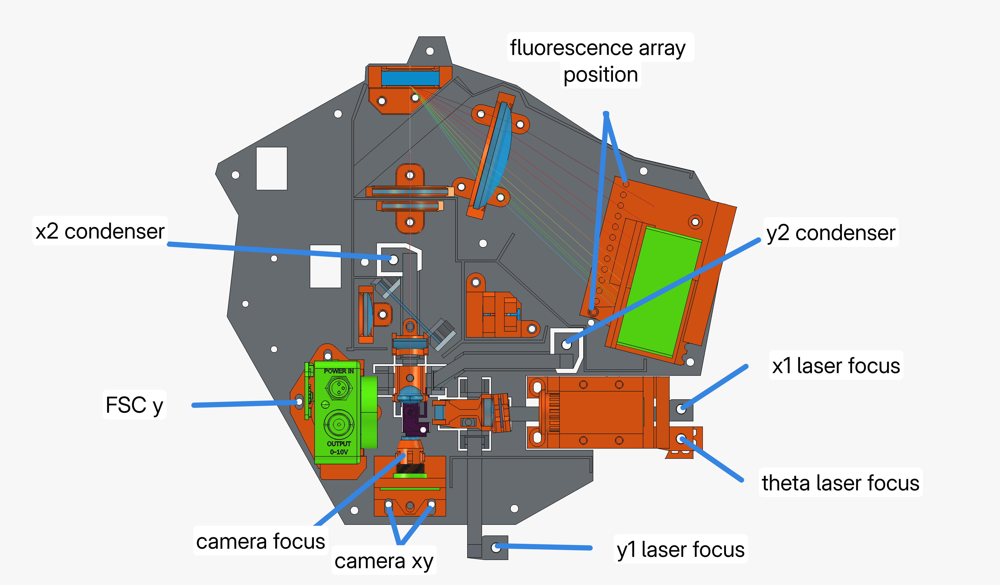
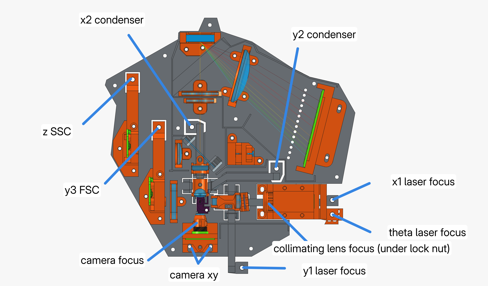

## Safety check {pagestep}
>! It is your responsibility to work with the laser safely. Safety depends not only on the protocol that you are following, but also your experience, the environment that you are working in, the people around you who may be exposed to the laser, and your particular set-up and sources of materials.
>! 
>! A risk assessment should consider all of the above factors.

The coarse alignment requires working with an exposed beam. However, if you have followed the assembly instructions so far, the beam should be fully blocked within the instrument with no intense reflections escaping. The direct beam passes from the laser module to the forward scatter detector where it is blocked.

It is advisable to perform the coarse alignment wearing laser safety glasses that block 488 nm light, as direct visualisation of the beam is not required. 

## Focus camera on cuvette channel {pagestep}

Move the camera to focus on the inner channel within the cuvette. You can use your host PC's USB camera software, or the Cytkit Hardware > Alignment Camera tab within Honeychrome. You may need to adjust the exposure and brightness to see a clear image. Start with the camera tube lens screwed in fully, then turn the camera lens one revolution anticlockwise. Then move the camera in xy to an approximate focus and screw the camera down. Finally turn the camera focus slightly to improve the image. You should see an image like the one below. Depending on whether you are using a round capillary or a square-section cuvette, it will look either blurry (like this, due to astigmatism in the round capillary) or sharp. 

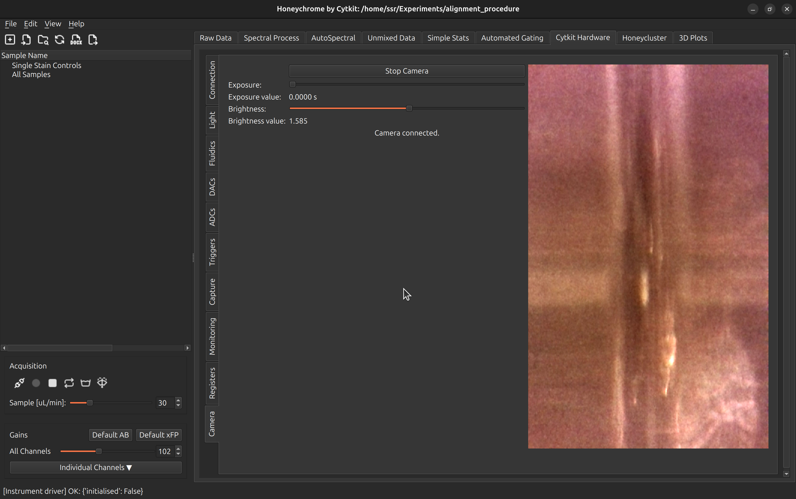

## Remove laser focus assembly {pagestep}

Carefully unscrew and remove the laser focus assembly as shown.

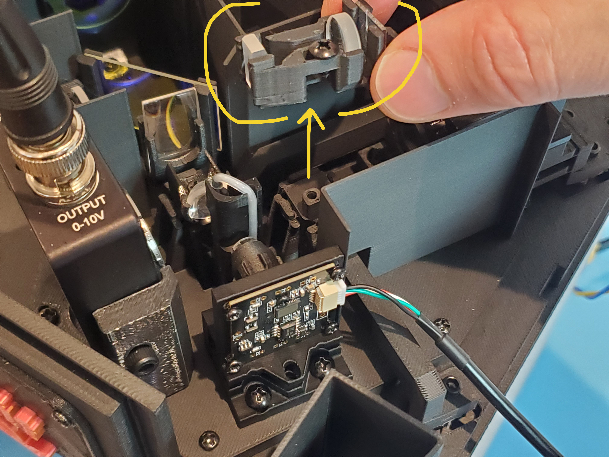

## Power on laser {pagestep}

For safety, ensure first that the laser is correctly seated within the instrument and the FSC detector mounted. 

Power on the laser by:

- 1S1F configuration: switch on the power directly
- 2S14F configuration: in Honeychrome, go to the Cytkit Hardware Tab, check that connection status says "Cytkit Connected". Then go to the "Light" tab. Check "Laser Enable", and uncheck "Interlock Enabled".

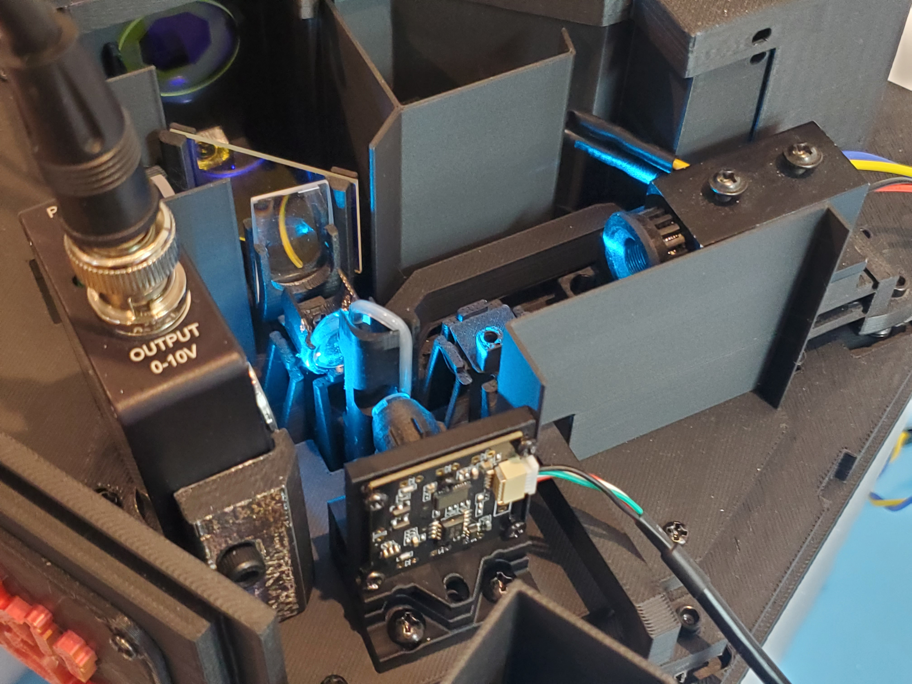
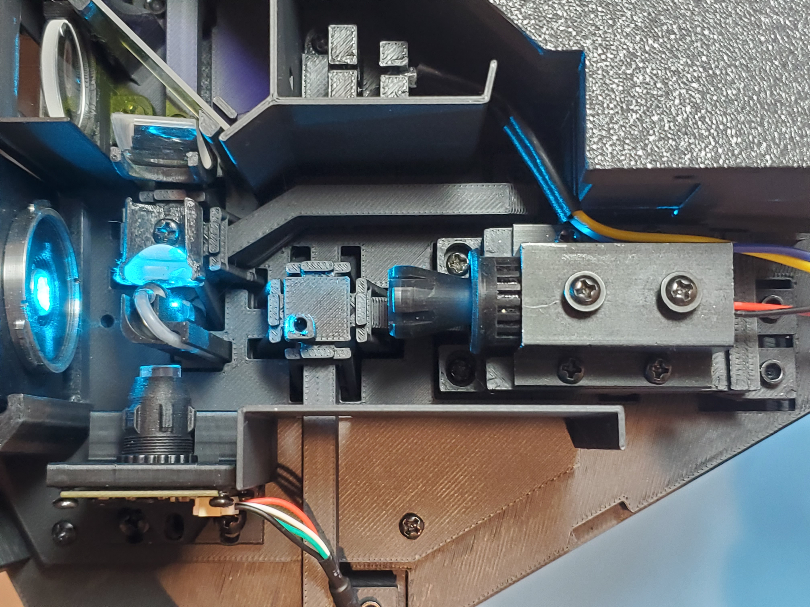

## Coarse laser collimation {pagestep}

Move the laser theta adjustment until you can see the blue laser light in the camera image. Insert the [laser collimating lens adjustment tool (long)](printed/lock_nut_tool_long.md){qty:1, cat:printed_resin} through the [laser collimating lens lock nut](printed/lock_nut.md) and gently rotate until it finds its location locking against the collimating lens mount. 

Then loosen the lock nut by rotating slightly anticlockwise. Now holding the lock nut still, rotate the laser collimating lens adjustment tool until the laser reaches a focus as seen in the camera image.

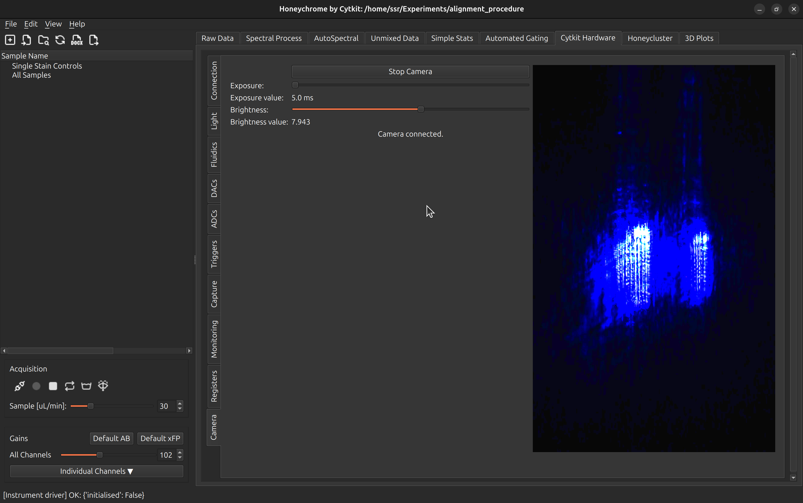

Finally rotate the laser collimating lens adjustment tool half a turn clockwise to defocus the laser beyond the cuvette. Lock the lock nut. You should see that the laser spot occupies about half the height of the camera field of view.

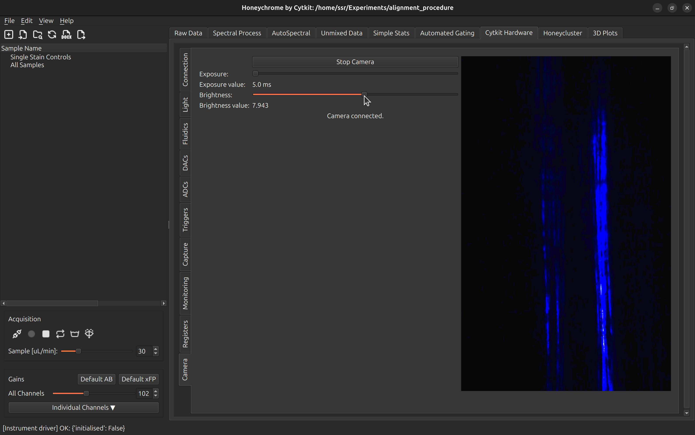

## Replace and coarsely align laser focus assembly {pagestep}

Switch off the laser again. Carefully replace the laser focus assembly into its position. Screw in loosely but do not tighten yet. Now switch the laser on again. You should be able to move the laser focus assembly by hand to bring it approximately to focus in the camera image. Once that is done, gently tighten the screw to hold it in place.

## Laser focus / collimation coarse adjustment {pagestep}

Using a mobile phone camera, look at the diffuse laser spot image going through the laser focus assembly lenses. The elliptical spot's major axis should be vertical: loosen the screws holding the laser module within its heatsink and rotate the laser module within the heatsink until the elliptical spot is vertically aligned.

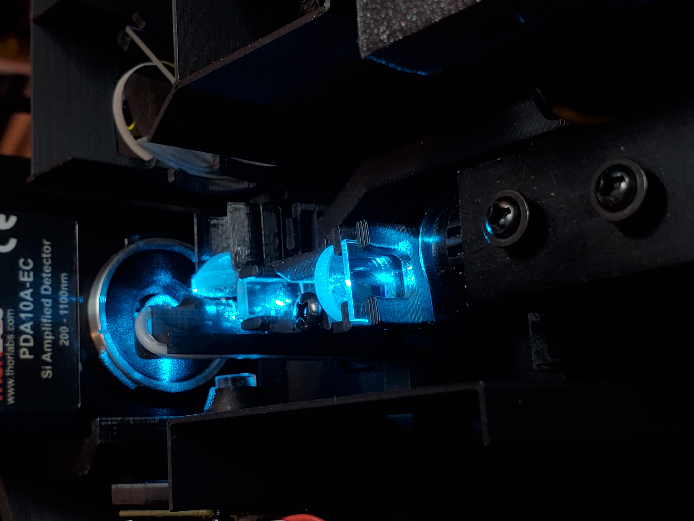
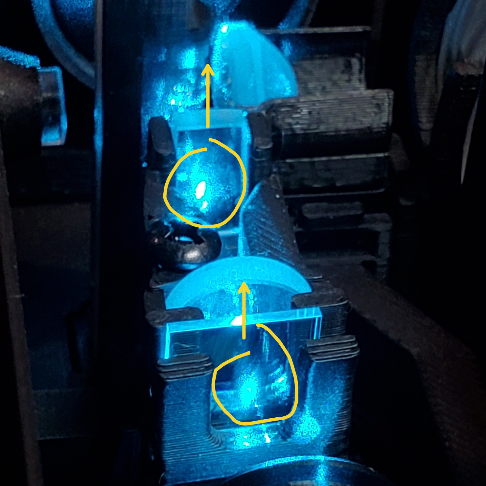

You should now be able to bring the laser to a focus within the camera image by turning the lead screws for x1, y1 and theta. The focused laser spot makes a narrow band of scattered light in the camera image as it enters and leaves the cuvette inner channel.

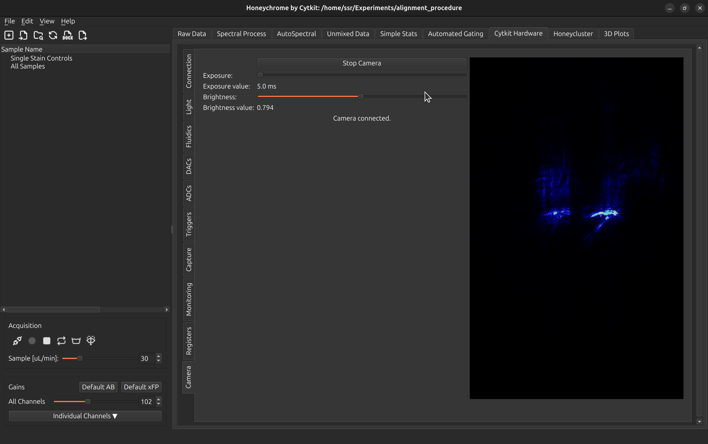

## Flow fluorescein solution (optional) {pagestep}

You can visualise the laser focus by flowing a dilute solution of fluorescein through the sample SIP. This allows direct visualisation of the spectrum on the array of detectors. Fill your sheath tank first with some suitable sheath fluid (e.g. deionised water or phosphate buffered saline). Dilute fluorescein in water (10 mg/mL) and put in a [5 mL flow cytometry test tube](test_materials/test_tube.md).

Switch on the sheath flow:

- for 1S1F configuration, power the pump directly with the power supply and motor controller;
- for 2S14F configuration, press the initialisation button in the acquisition widget.

Load a sample:

- for 1S1F configuration, power the stepper motor directly, and with the stepper motor controller, determine which direction is positive flow into the cuvette;
- for 2S14F configuration, press the start button in the acquisition widget.

Adjust laser focus theta so that the fluorescent light emission enters the detector. Adjust x2 condenser so that the fluorescent light is well focused at the detector.

To see the emission spectrum clearly, hold a white screen (e.g. paper) in front of the fluorescence detectors as shown.

<video src="images/build photos/alignment/fluorescein spectrum.mp4" controls width="640"></video>

Wash out well with sheath fluid before moving on, as residual fluorescein creates a lot of background fluorescence. Load sheath fluid or water onto the SIP, then flush:

- for 1S1F configuration, use the stepper motor controller to wash out the input line for 5 minutes;
- for 2S14F configuration, press the flush button in the acquisition widget. Repeat several times.

## Mount fluorescence chamber lid {pagestep}

Place the fluorescence compartment cap in place.

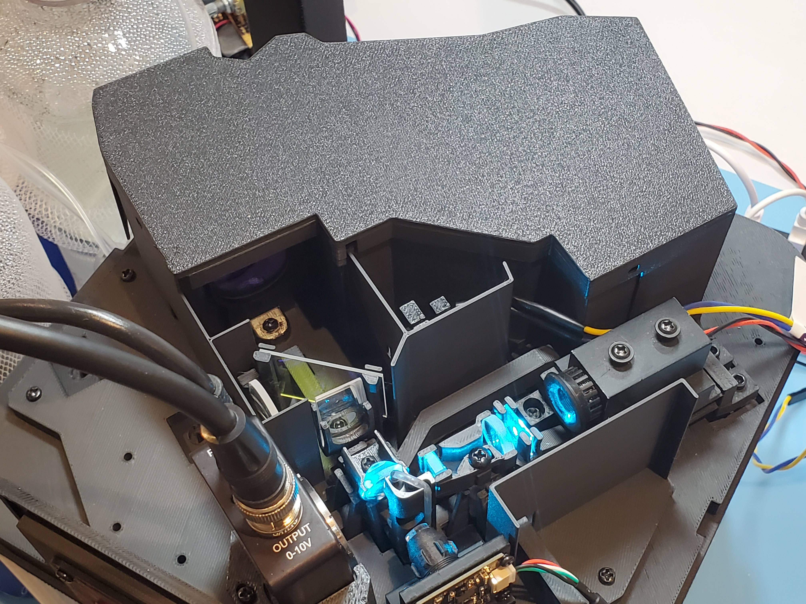

## Mount instrument cover (Cytkit 2S14F only) {pagestep}

If you are building the Cytkit configuration 2S14F, you may now put on the instrument cover and enable the interlock again.

If you are building the Cytkit configuration 1S1F, do not place the instrument cover yet, as it must be off to access the FSC alignment in the next step.

You are now ready to move on to fine alignment.