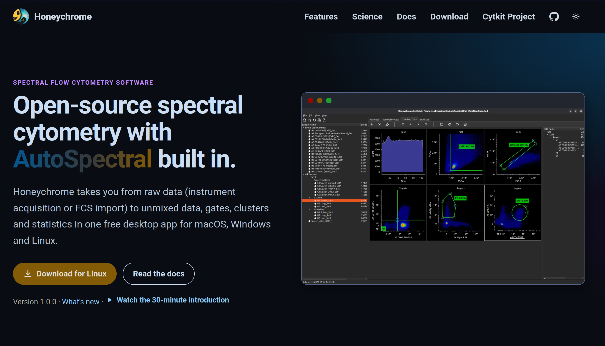

# Install and run the software

## Install Honeychrome  {pagestep}

Honeychrome is an open-source cross-platform software package for flow cytometry data acquisition and analysis. It contains drivers for both Cytkit 1S-1F and Cytkit 2S-14F.

The Honeychrome package can be downloaded for Windows, MacOS or Linux, run from Python source or the Python package manager PyPI. See [https://honeychrome.cytkit.com/](https://honeychrome.cytkit.com/) for full instructions.

## Install Picoscope software (Cytkit configuration 1S-1F only)  {pagestep}

Honeychrome includes a driver to acquire data from a Cytkit 1S-1F using the Picoscope 5000 series oscilloscope. However this requires the separate download and installation of the [PicoSDK from Pico Technology](https://www.picotech.com/library/our-oscilloscope-software-development-kit-sdk).

In addition, for the Cytkit configuration 1S-1F only, it is recommended to install the Picoscope software (Picoscope 7) for the Picoscope 5000 series oscilloscope can be downloaded from [picotech.com](https://picotech.com). It is useful in the exploration and recording of data from the oscilloscope. It cannot be run simultaneously with the Honeychrome app.

## Connect to hardware and run Honeychrome  {pagestep}

Connect your Cytkit via a USB cable to your host PC and power it on. Then run Honeychrome. Enable the Cytkit Hardware Tab by going to App Configuration > Bundled Plugin > checkbox "Cytkit Hardware".

If your hardware is functioning correctly, Honeychrome will report a successful connection.