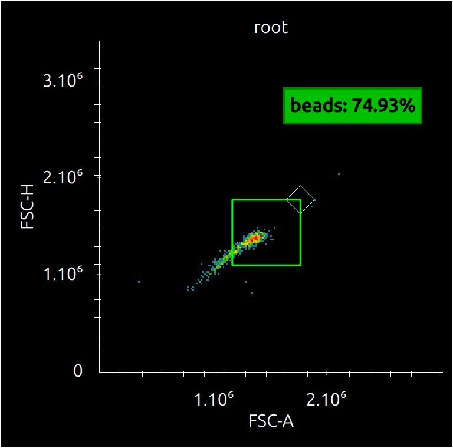
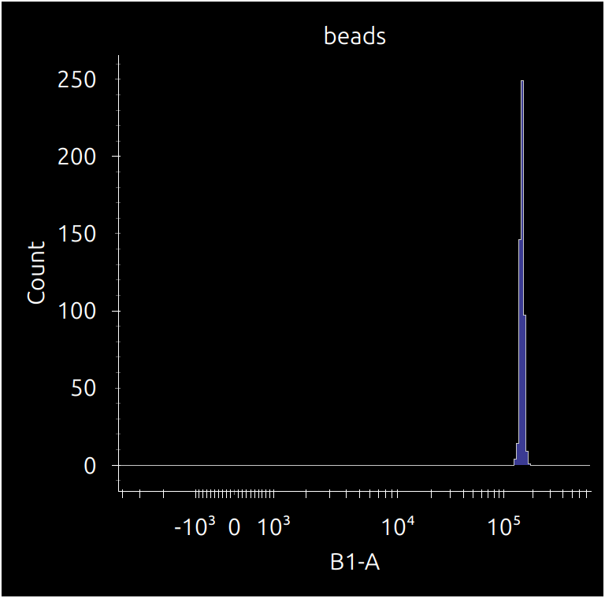
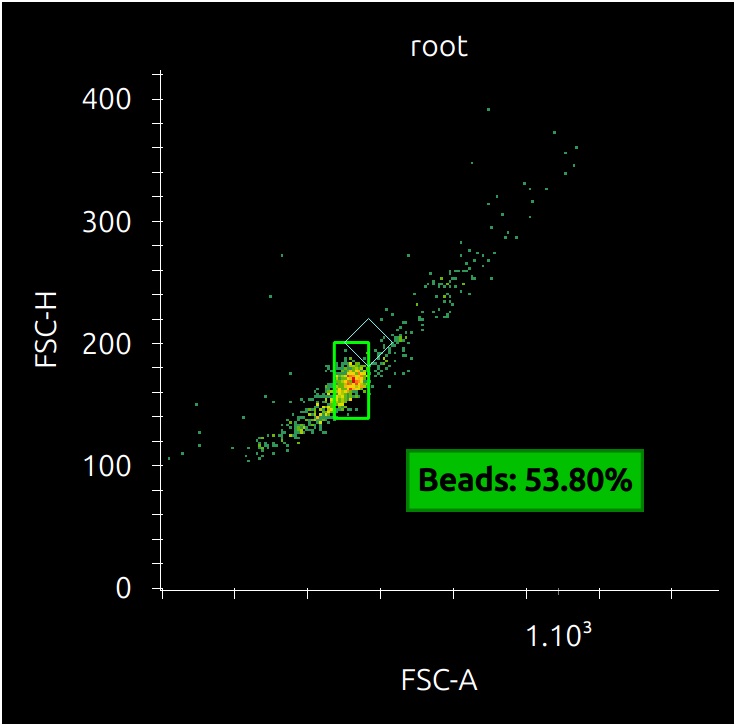
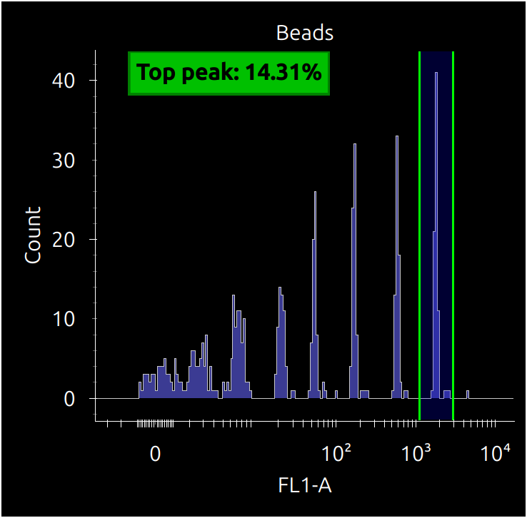

# Test your Cytkit cytometer

Your Cytkit instrument should now be fully aligned and working with its case on.

## Flow alignment beads {pagestep}

You can flow alignment beads as in the previous step. In Honeychrome, you should see tight populations in FSC and fluorescence as shown below.

## Flow rainbow beads {pagestep}

Rainbow beads are commonly used as a check of an instrument's sensitivity, dynamic range and precision in a fluorescence channel. A commonly used rainbow bead source is Spherotech with 3 um 8-peak beads (RCP-30-5a), and 6 um 6-peak beads (RCP-60-5).

- Sensitivity is tested by the number of populations that can be resolved separate from their neighbours, ideally all 8 in case of the Spherotech RCP-30-5a.
- Dynamic range is tested by the number of populations that can be resolved simultaneously, ideally all 8 in case of the Spherotech RCP-30-5a.
- Precision is tested by the robust coefficient of variation (rCV) of the brightest population.

Your Cytkit 2S14F should be able to resolve all 8 peaks of Spherotech RCP-30-5a in the PE peak channel. 

## Clean fluidics system {pagestep}

Congratulations! If you have got this far, your Cytkit cytometer is hopefully fully working.

To keep it working well, make sure the fluidics system is regularly cleaned to prevent build-up of a microbial biofilm in the sheath and sample lines and clogging of the cuvette.

The following generic cleaning agents are suitable. One should perform the detergent wash first to remove residues before the disinfection. Finally flush with water to prevent build-up of salt crystals or damage to the fluidics.

1. Detergent wash: e.g. Tween 20 (1%), Triton X-100 (0.1%), 7X detergent (1%), Contrad 70 (1%) or dish soap (1%) in DI water
2. Disinfection: 70% ethanol or isopropanol + 30% DI water, or 1% hydrogen peroxide in DI water
3. Flush: DI water

It is recommended to clean the entire fluidics once per month: load sheath bottle with each cleaning agent in order and flow each for 10 minutes with backflush of the sample line.

After flowing biological samples, it is recommended to flush each cleaning agent through the SIP for 2 minutes.

## Let us know your feedback {pagestep}

This step is very important! The Cytkit contributors have put a lot of hard work into this project, and we need feedback if it is to grow and continue. [Please let us know how your build went, and any feedback or ideas.](https://cytkit.com/contact/)